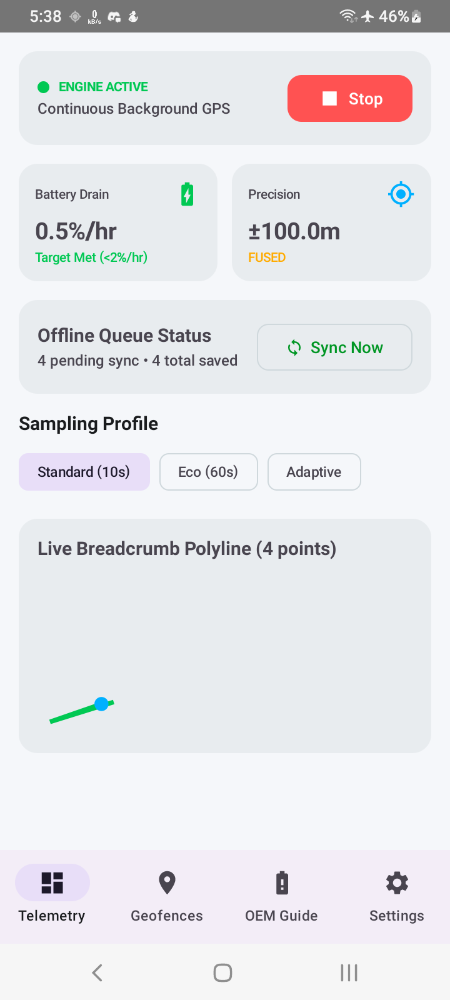
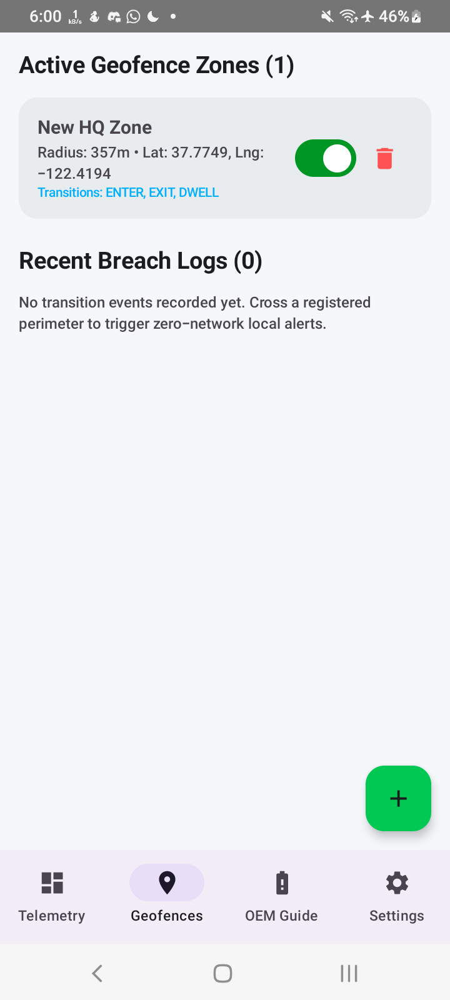
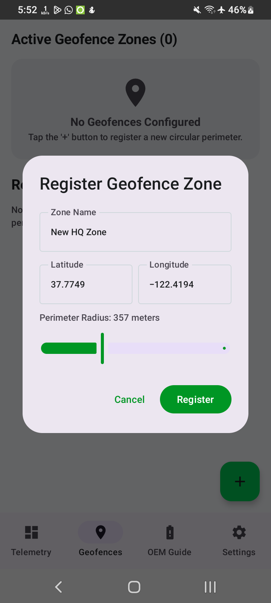
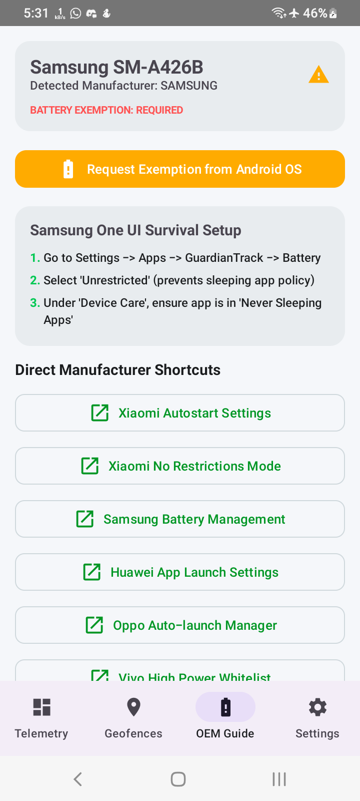
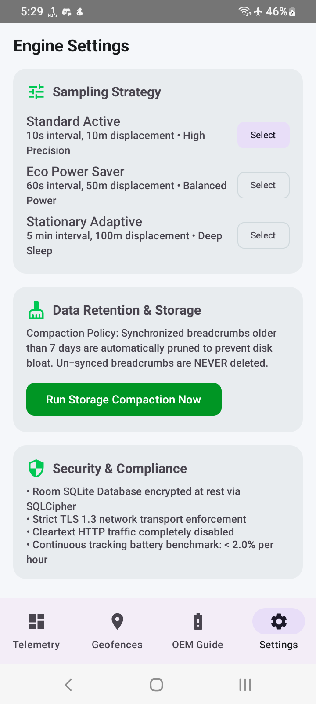

# GuardianTrack: Offline-First Android Background Location & Geofencing Engine

> **Production-Grade Offline-First Android Background Location & Geofencing Engine**  
> Built for Android 8.0 (API 26) through Android 15 (API 35) with 100% Kotlin, Jetpack Compose, Clean Architecture, and Room DB.

[-green.svg)](https://developer.android.com)
[](https://kotlinlang.org)
[](https://developer.android.com/jetpack/compose)
[-brightgreen.svg)]()
[]()
[](LICENSE)

---

## Overview

**GuardianTrack** solves the industry-wide problem where modern Android versions (Android 10 through 15) and aggressive OEM battery killers (Samsung One UI, Xiaomi HyperOS, Huawei EMUI, Oppo ColorOS) terminate background location services, drop breadcrumbs, and suppress geofencing alarms.

GuardianTrack delivers an enterprise reference engine designed to:
- **Survive OEM Killers:** Integrated OEM Survival Wizard with direct intent routing for Xiaomi, Samsung, Huawei, Oppo, and Vivo.
- **Maintain High Accuracy at Low Power (<2%/hr):** Adaptive sampling throttles GPS updates to 5-minute intervals when stationary using Google Play Services `ActivityRecognitionClient`.
- **Zero Data Loss:** Offline-first architecture stores all breadcrumbs and geofence breaches in local Room SQLite with `syncStatus = PENDING` before remote transport.
- **Instant Hardware Geofencing:** Dispatches zero-network local heads-up notifications with sound and vibration even in Deep Doze.

---

## Production Screenshots (Captured on Samsung Galaxy A42 5G)

| Telemetry Dashboard | Geofences Manager | Perimeter Creation | OEM Survival Guide | Engine Settings |
|:---:|:---:|:---:|:---:|:---:|
|  |  |  |  |  |

---

## Architecture Blueprint

```
┌────────────────────────────────────────────────────────┐
│                   Presentation Layer                   │
│   (Jetpack Compose UI, ViewModels, UiState, UiEvent)   │
└──────────────────────────┬─────────────────────────────┘
                           │ Observes State & Emits Events
                           ▼
┌────────────────────────────────────────────────────────┐
│                      Domain Layer                      │
│      (Pure Kotlin UseCases, Models, Repositories)      │
└──────────────────────────┬─────────────────────────────┘
                           │ Calls Repository Contracts
                           ▼
┌────────────────────────────────────────────────────────┐
│                       Data Layer                       │
│    (Repository Impls, Room DB, Retrofit TLS 1.3)       │
└────────────────────────────────────────────────────────┘
```

- **Domain Independence:** 100% pure Kotlin; zero `android.*` framework imports in `core/domain`.
- **MVI Unidirectional Data Flow:** ViewModels expose single immutable `StateFlow<UiState>` collected in Compose via `collectAsStateWithLifecycle()`.
- **Dual-Layer Resilience:** Combines OS `START_STICKY` with a 15-minute `WorkManager` watchdog worker for automatic process resurrection.
- **Network Security:** Strict TLS 1.3 enforcement and `cleartextTrafficPermitted="false"`.

---

## Project Structure

```
com.guardiantrack/
├── core/
│   ├── common/           # Result wrapper, CoroutineDispatchers
│   ├── model/            # Pure Kotlin Domain entities (LocationPoint, GeofenceZone)
│   ├── domain/           # Repository interfaces & Single-purpose Use Cases
│   ├── database/         # Encrypted Room DB, DAOs, Entities, TypeConverters
│   ├── network/          # Retrofit / TLS 1.3 client, DTOs, Serialization
│   ├── location/         # FusedLocationEngine, GeofencingEngine, Service, Receivers
│   ├── oem/              # OEM Battery Survival Engine & Intent Registry
│   └── data/             # Repository implementations & Domain-Data Mappers
├── presentation/         # Jetpack Compose UI (Theme, Navigation, Dashboard, Geofences, OEM, Settings)
└── di/                   # Dagger Hilt Modules (App, Database, Network, Location, Repository)
```

---

## Quick Start & Verification

### Build the Debug APK
```bash
./gradlew assembleDebug
```

### Run Automated Unit Test Suites
```bash
./gradlew testDebugUnitTest
```
*(Executes 71 tests across 12 test suites covering Mappers, Use Cases, Repositories, and ViewModels with Turbine).*

---

## License

```
Copyright 2026 Muhammad Taqi

Licensed under the Apache License, Version 2.0 (the "License");
you may not use this file except in compliance with the License.
You may obtain a copy of the License at

    http://www.apache.org/licenses/LICENSE-2.0

Unless required by applicable law or agreed to in writing, software
distributed under the License is distributed on an "AS IS" BASIS,
WITHOUT WARRANTIES OR CONDITIONS OF ANY KIND, either express or implied.
See the License for the specific language governing permissions and
limitations under the License.
```
